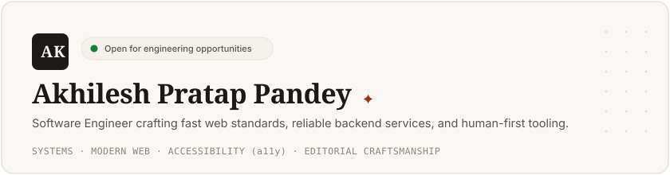

<!-- Discord-Inspired Profile Card Banner with Curated Artwork & Overlapping Avatar -->

  

---

### ✦ Philosophy & Craftsmanship

> *"Perfection is achieved, not when there is nothing more to add, but when there is nothing left to take away."* — Antoine de Saint-Exupéry

I am a developer and builder focused on **human software craftsmanship**, **resilient systems architecture**, and **zero-bloat web standards**. I believe in writing authentic, readable code that stands the test of time:

- ⚡ **Zero-Bloat Performance:** 100/100 Lighthouse audits, zero layout shifts, and instantaneous load times.
- 🎨 **Tactile Design Systems:** Melding editorial typography (`Newsreader`), monospace clarity (`JetBrains Mono`), and OKLCH colorimetry math.
- ♟️ **First-Principles Thinking:** Deconstructing complex software, human behavior, and game mechanics into clean, modular building blocks.

---

### 💼 Featured Open-Source Work

<table>
  <thead>
    <tr>
      <th align="left">Project</th>
      <th align="left">Description</th>
      <th align="left">Tech Stack</th>
      <th align="center">Links</th>
    </tr>
  </thead>
  <tbody>
    <tr>
      <td><strong><a href="https://github.com/heyitsak/plotfolio">PlotFolio</a></strong></td>
      <td>Modern personal developer portfolio featuring a Discord-inspired profile card, dynamic rotating banners, and editorial typography.</td>
      <td><code>Vanilla JS</code> <code>CSS Variables</code> <code>Semantic HTML5</code></td>
      <td align="center">
        <a href="https://github.com/heyitsak/plotfolio"><strong>Repo</strong></a> · 
        <a href="https://heyitsak.github.io/plotfolio/"><strong>Live</strong></a>
      </td>
    </tr>
    <tr>
      <td><strong><a href="https://github.com/heyitsak/codeforge">CodeForge</a></strong></td>
      <td>Interactive coding mastery platform featuring fast muscle-memory drills, live memory visualization, and structured learning roadmaps.</td>
      <td><code>TypeScript</code> <code>React</code> <code>Vite</code> <code>Tailwind</code></td>
      <td align="center">
        <a href="https://github.com/heyitsak/codeforge"><strong>Repo</strong></a>
      </td>
    </tr>
    <tr>
      <td><strong><a href="https://github.com/heyitsak/polycoder">PolyCoder</a></strong></td>
      <td>Gamified coding engine featuring 7 language tracks, zero-to-grandmaster progression system, and in-browser execution sandboxes.</td>
      <td><code>TypeScript</code> <code>Web Sandboxing</code> <code>Modern UI</code></td>
      <td align="center">
        <a href="https://github.com/heyitsak/polycoder"><strong>Repo</strong></a>
      </td>
    </tr>
    <tr>
      <td><strong><a href="https://github.com/heyitsak/news-map">NewsMap</a></strong></td>
      <td>Interactive cyberpunk-themed global news & intelligence visualizer tracking real-time events across an interactive 3D/2D projection.</td>
      <td><code>React 19</code> <code>Vite</code> <code>React Simple Maps</code> <code>GeoJSON</code></td>
      <td align="center">
        <a href="https://github.com/heyitsak/news-map"><strong>Repo</strong></a>
      </td>
    </tr>
    <tr>
      <td><strong><a href="https://github.com/heyitsak/onex-portal">OneX Portal</a></strong></td>
      <td>Full-stack member management, support ticketing, and service portal built with enterprise-grade reliability and fast data caching.</td>
      <td><code>Next.js 16</code> <code>React 19</code> <code>Tailwind CSS</code> <code>REST APIs</code></td>
      <td align="center">
        <a href="https://github.com/heyitsak/onex-portal"><strong>Repo</strong></a>
      </td>
    </tr>
    <tr>
      <td><strong><a href="https://github.com/heyitsak/gpchopan-website">GPChopan Institutional</a></strong></td>
      <td>Official institutional website redesign for Government Polytechnic Chopan focusing on responsiveness, a11y, and rapid load times.</td>
      <td><code>HTML5</code> <code>Modern CSS</code> <code>Vanilla JS</code></td>
      <td align="center">
        <a href="https://github.com/heyitsak/gpchopan-website"><strong>Repo</strong></a>
      </td>
    </tr>
  </tbody>
</table>

---

### 🗺️ Curiosity Map

<table width="100%">
  <tr>
    <td width="33%" valign="top">
      <h4>🧠 Psychology &amp; Human Behavior</h4>
      
Why people decide, connect, and trust. Studying emotional intelligence, intention recognition, and the dynamics of leadership and influence.

      <code>Decision Influence</code> 
      <code>Emotional Intelligence</code> 
      <code>Trust &amp; Intentions</code> 
      <code>Behavioral Dynamics</code>
    </td>
    <td width="33%" valign="top">
      <h4>♟️ Strategy, Logic &amp; Chess</h4>
      
Deep calculation under constrained resources. Finding the objectively superior move, positional intuition, and translating chess thinking into real decisions.

      <code>Chess Calculation</code> 
      <code>Game Theory</code> 
      <code>Pattern Recognition</code> 
      <code>Systemic Optimization</code>
    </td>
    <td width="33%" valign="top">
      <h4>⚙️ Systems &amp; Software Construction</h4>
      
Building software from first principles. How instructions execute, how networks communicate, and writing clean, human-crafted code without build bloat.

      <code>Web Standards</code> 
      <code>TypeScript</code> 
      <code>Distributed Architecture</code> 
      <code>Open Source Tooling</code>
    </td>
  </tr>
</table>

---

### 🛠 Technical Arsenal

<table>
  <tr>
    <td width="25%" valign="top"><strong>Languages & Core</strong></td>
    <td width="75%">
      <code>JavaScript (ES6+)</code> &nbsp;
      <code>TypeScript</code> &nbsp;
      <code>Python</code> &nbsp;
      <code>C++</code> &nbsp;
      <code>HTML5 Semantic</code> &nbsp;
      <code>Modern CSS3</code> &nbsp;
      <code>SQL</code>
    </td>
  </tr>
  <tr>
    <td width="25%" valign="top"><strong>Frontend & UI</strong></td>
    <td width="75%">
      <code>React 19</code> &nbsp;
      <code>Next.js 16</code> &nbsp;
      <code>Vite</code> &nbsp;
      <code>Tailwind CSS</code> &nbsp;
      <code>Web Workers</code> &nbsp;
      <code>WCAG AAA Accessibility</code>
    </td>
  </tr>
  <tr>
    <td width="25%" valign="top"><strong>Backend & Systems</strong></td>
    <td width="75%">
      <code>Node.js</code> &nbsp;
      <code>Express</code> &nbsp;
      <code>RESTful APIs</code> &nbsp;
      <code>Reverse Proxies</code> &nbsp;
      <code>Rate Limiting</code> &nbsp;
      <code>Microservices</code>
    </td>
  </tr>
  <tr>
    <td width="25%" valign="top"><strong>Databases & Storage</strong></td>
    <td width="75%">
      <code>PostgreSQL</code> &nbsp;
      <code>Redis</code> &nbsp;
      <code>SQLite</code> &nbsp;
      <code>MongoDB</code> &nbsp;
      <code>LocalStorage / IndexedDB</code>
    </td>
  </tr>
  <tr>
    <td width="25%" valign="top"><strong>DevOps & Infra</strong></td>
    <td width="75%">
      <code>Docker</code> &nbsp;
      <code>Linux / Bash</code> &nbsp;
      <code>Git &amp; GitHub Actions</code> &nbsp;
      <code>Prometheus</code> &nbsp;
      <code>CI/CD Pipelines</code>
    </td>
  </tr>
</table>

---

### 📊 GitHub Activity & Insights

  <table border="0">
    <tr>
      <td align="center" width="50%">
        
      </td>
      <td align="center" width="50%">
        
      </td>
    </tr>
    <tr>
      <td align="center" colspan="2">
        
      </td>
    </tr>
  </table>

---

### 📫 Connect & Inquiries

  Whether you're looking to discuss distributed systems, modern web craftsmanship, open engineering roles, or collaboration opportunities — my inbox is always open.

  
  &nbsp;&nbsp;
  
  &nbsp;&nbsp;
  

  ✦ Crafted with intentional minimalism &amp; Discord aesthetic · Ak (@heyitsak) ✦

